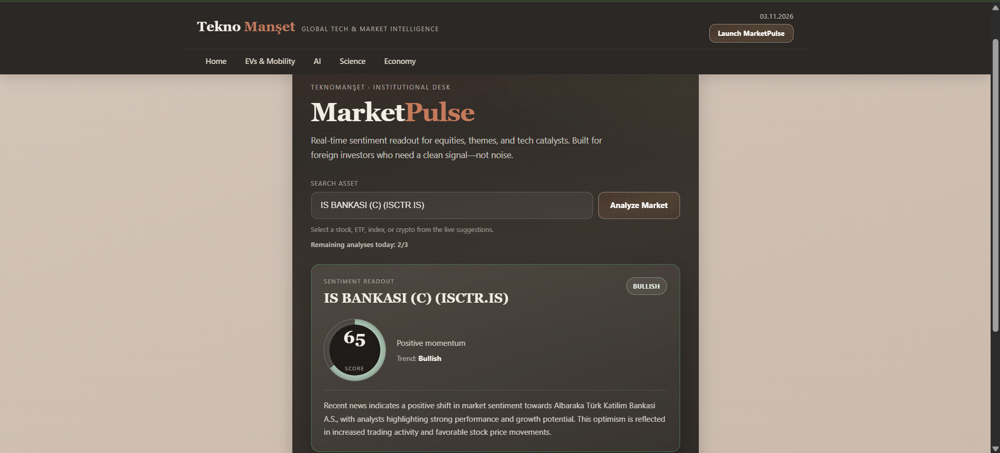
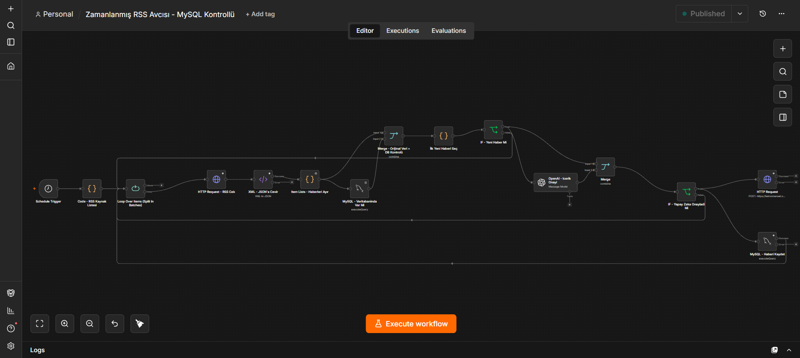
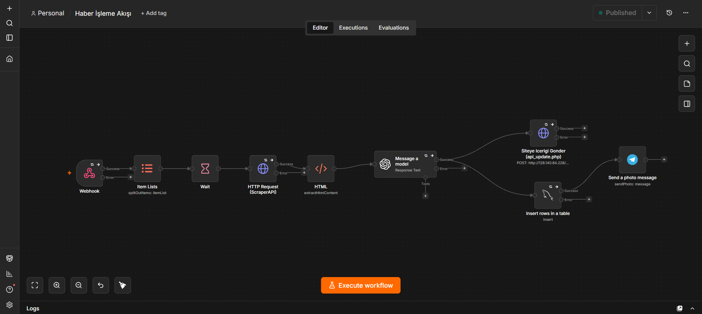
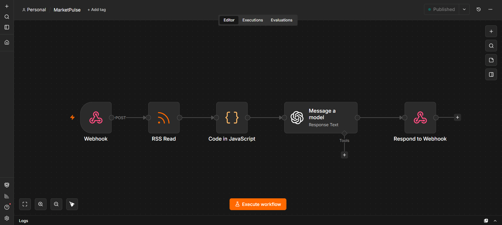

# TeknoManset-Architecture

**Note:** *Due to security, proprietary algorithms, and active API integrations, the raw source code of this project is kept in a private repository. This showcase outlines the system architecture, automation workflows, and technical stack used to build the platform.*

##  Project Overview
https://teknomanset.net

An autonomous, AI-driven tech news portal that continuously hunts, curates, translates, and publishes global technology news with zero human intervention. The system integrates advanced RSS scraping, NLP-based sentiment/relevance analysis, and dynamic UI rendering.

##  Technical Stack & Architecture
- **Backend Flow:** PHP 8.x, SQLite (ACID compliant with `BEGIN IMMEDIATE` transaction locking)
- **Automation Engine:** n8n (Node-based workflow automation)
- **AI Integration:** OpenAI API (Content rewriting, summarization, and context preservation)
- **Security:** 
  - Advanced Rate-Limiting & Spam Protection (IPv6 /64 subnet blocking)
  - Custom API Key Header Authentication
  - Cloudflare Real-IP detection and masking
- **Frontend:** HTML5, CSS3, JavaScript (AJAX, Asynchronous UI updates)

##  Core Features & Workflows
1. **Scheduled RSS Hunter (n8n):** Scrapes top-tier global sources (e.g., TechCrunch, Wired, InsideEVs) across specific categories (AI, Science, EV, Economy).
2. **AI Content Processing:** Filters out irrelevant news, translates English content to Turkish, and rewrites it in a unique journalistic tone to prevent SEO duplication.
3. **Database Security:** Employs strict SQLite locking mechanisms to prevent race conditions during high-volume API requests.
4. **MarketPulse Analyzer:** A user-facing AI tool that allows visitors to perform quick sentiment and market analysis on trending topics, protected by a strict daily IP rate limit system.

##  Engineering Highlights
- **Bulletproof Rate Limiting:** Developed a custom failure-tracking system that blocks malicious IPs after consecutive irrelevant queries without taxing the AI API.
- **Resilient Workflows:** Designed n8n flows with "Continue On Error" contingencies, ensuring that one failed RSS source does not crash the entire content pipeline.

*Developed as a demonstration of full-stack automation and AI integration capabilities.*

##  Project Showcase & Architecture Diagrams

### Frontend Interface

### Backend Automation & AI Workflows (n8n)
**1. Scheduled RSS Hunter & MySQL Control Flow:**

**2. AI Content Curation & Publication Flow:**

**3. MarketPulse Real-time Analysis Flow:**

